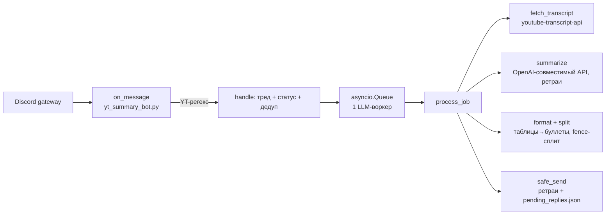
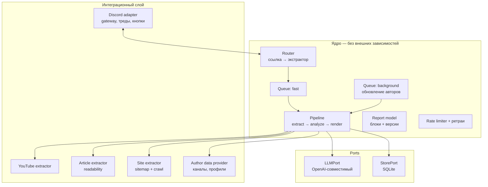
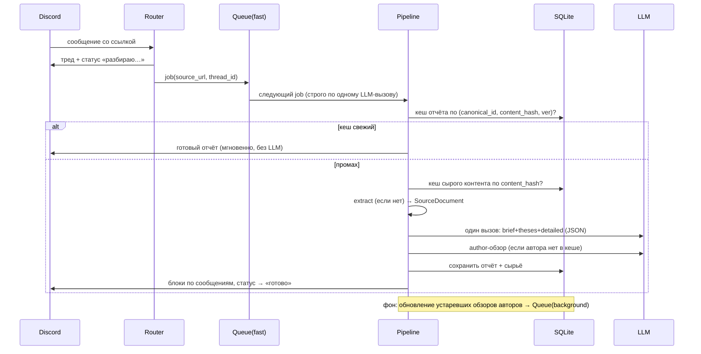

# Архитектура yt_summary_bot

Документ описывает: текущее состояние (as-is), целевую архитектуру (to-be)
под плановые доработки и поэтапный план миграции. Читать вместе с
[TESTING.md](TESTING.md) и [AGENTS.md](../AGENTS.md).

## 1. Видение

Сейчас бот умеет одно: YouTube-ссылка → тезисы по субтитрам в треде.
Целевое состояние — **аналитик любых ссылок с прогрессивной детализацией**:

- **Любые источники**: видео (YouTube, позже — другие платформы), статьи по URL,
  целые сайты («что за сайт, возможности, что даёт и о чём»).
- **Разбор по блокам**, чтобы читатель решал сам, насколько углубляться:
  1. **Кратко** — суть в 1–2 строки;
  2. **Тезисно** — 5–9 пунктов;
  3. **Подробно** — по разделам; для видео — с таймкодами-ссылками;
  4. **Автор** — кто такой, чем занимается, популярность, критика.
- **База знаний**: кеширование разобранных источников и авторов, периодическое
  обновление обзоров авторов. Повторная ссылка на известное видео отвечает
  мгновенно и бесплатно.
- **Понятно неподготовленному читателю**: сложные темы сопровождаются
  коротким контекстом «простым языком», но общий объём разбора ограничен.

## 2. Принципы

1. **Пайплайн в ядре, интеграции по краям** (hexagonal / ports & adapters).
   Внешний мир (Discord, LLM-API, источники, БД) — за интерфейсами-портами.
   Следствие: всё ядро тестируется без сети (см. `tests/e2e/`).
2. **Кеш и идемпотентность на каждом шаге**: сырой контент, отчёт, обзор
   автора — всё персистентно и переиспользуется.
3. **Прогрессивная детализация — продуктовый принцип** и формат данных
   (отчёт = список блоков), а не только стиль промптов.
4. **Один LLM-воркер для пользовательских задач** — провайдеры лимитируют,
   очередь уже доказала себя. Фоновые задачи (обновление авторов) — отдельная
   низкоприоритетная очередь.
5. **SQLite, пока не станет тесно**: один файл, WAL, бэкап копированием,
   объём данных этого бота — мегабайты.
6. **Эволюция без big-bang**: миграция strangler-паттерном, бот остаётся
   рабочим после каждой фазы (план в §12).

## 3. As-is (исходное состояние, до фазы 0)

> Историческая справка: всё ниже было в одном файле `yt_summary_bot.py`.
> Фаза 0 расщепила его в пакет `bot/` (см. §11) без изменения поведения.



Всё в одном файле `yt_summary_bot.py` (~570 строк). Сильные стороны, которые
**переносятся как есть**: очередь с сериализацией LLM-вызовов, ретраи с
`Retry-After`, персистентный буфер недоставленных сообщений, fence-aware
сплит, конвертация таблиц, переиспользование треда при 160004.

Ограничения as-is, которые целевая архитектура снимает:

| Ограничение | Причина | Решение в to-be |
|---|---|---|
| Только YouTube | экстрактор зашит в пайплайн | порт `Extractor` + реестр |
| Нет кеша: повторная ссылка = новый LLM-вызов | нечего адресовать | SQLite: sources/reports |
| Один блок «тезисы», LLM-ответ — свободный текст | промпт не структурирован | отчёт из блоков, JSON-схема ответа |
| Обзор автора невозможен | нет сущности автора | `AuthorRef` + кеш с TTL |
| Очередь/дедуп в памяти | нет персистентности | задачи в БД, outbox в БД |
| Тестируемость через monkeypatch модуля | side-effects на импорте | DI: порты передаются явно |

## 4. To-be: контекстная диаграмма



## 5. Доменная модель

```
Source          — всё, что имеет URL: видео, статья, сайт
SourceKind      = video | article | site
SourceDocument  — результат экстракции (нормализованный):
                  canonical_id, kind, url, title, lang,
                  author: AuthorRef | None,
                  content: str            # текст с разметкой [MM:SS] для видео
                  sections: [Section]     # title, start_sec (если известны)
                  fetched_at, content_hash
AuthorRef       — (platform, handle/channel_id) — стабильный ключ автора
AuthorProfile   — факты об авторе: имя, описание, ссылки, метрики, найдено когда
AuthorReview    — LLM-разбор автора по фактам (+ дата, версия промпта)
Report          — [ReportBlock], где ReportBlock = (kind, title, body_md, ver)
ReportBlock.kind = brief | theses | detailed | author | context
```

Ключевые решения:

- **Таймкоды остаются в `content`** (формат `[MM:SS] текст` уже есть в as-is) —
  LLM возвращает границы секций в секундах, рендерер превращает их в
  `https://youtu.be/<id>?t=<sec>`.
- **Автор — отдельная сущность**, на которую ссылается много источников:
  один канал = много видео, обзор считаем один раз и переиспользуем.
- **Блоки первого класса**: кешируются, рендерятся и доставляются по отдельности.

## 6. Пайплайн обработки



Стадии конвейера:

1. **Router** — матчинг URL экстракторами (упорядоченный реестр по специфичности),
   дедуп (пары «сообщение + canonical_id» в БД), создание треда и статусного
   сообщения, постановка job.
2. **Extract** — `Extractor.extract(url) -> SourceDocument`. Кеш сырья по
   `content_hash`: пересчёт отчёта после смены промптов не тянет страницу заново.
3. **Analyze** — два типа LLM-вызовов:
   - **контент-вызов** (один): вход — SourceDocument, выход — JSON
     `{brief, theses[], sections[{title, start_sec, body}], context}`
     (context — «простым языком» для сложных тем, опционально);
   - **автор-вызов**: вход — AuthorProfile (факты!) + свежий контент,
     выход — обзор. Кешируется отдельно с TTL.
4. **Render** — Report → список Discord-сообщений (§9).
5. **Deliver** — safe_send с ретраями; недоставленное — в outbox (таблица БД,
   обобщение сегодняшнего `pending_replies.json`), порядок сохраняется.

Кеш-ключ отчёта: `(canonical_id, content_hash, prompts_ver, report_schema_ver)`.
Смена промпта или схемы детерминированно инвалидирует старые отчёты —
ручной сброс кеша не нужен.

## 7. Хранилище (SQLite)

```sql
-- разобранные источники
CREATE TABLE sources (
  canonical_id TEXT PRIMARY KEY,     -- youtube:video:<id> | article:<norm-url> | site:<domain>
  kind         TEXT NOT NULL,
  url          TEXT NOT NULL,
  title        TEXT,
  author_platform TEXT,
  author_handle    TEXT,             -- FK → authors
  content_hash TEXT NOT NULL,        -- инвалидация при изменении контента
  raw          TEXT,                 -- субтитры/текст (кеш сырья)
  meta_json    TEXT,                 -- метаданные, специфичные для kind
  fetched_at   INTEGER NOT NULL
);

-- отчёты (все версии, свежая — по max(created_at))
CREATE TABLE reports (
  canonical_id TEXT NOT NULL,
  prompts_ver  TEXT NOT NULL,
  schema_ver   TEXT NOT NULL,
  blocks_json  TEXT NOT NULL,        -- [ReportBlock…]
  created_at   INTEGER NOT NULL,
  PRIMARY KEY (canonical_id, prompts_ver, schema_ver)
);

-- авторы: факты + LLM-обзор с TTL
CREATE TABLE authors (
  platform     TEXT NOT NULL,
  handle       TEXT NOT NULL,
  display_name TEXT,
  profile_json TEXT,                 -- факты (для повторных LLM-разборов)
  review_json  TEXT,                 -- текущий LLM-обзор
  prompts_ver  TEXT,
  analyzed_at  INTEGER,              -- когда делали обзор
  refreshed_at INTEGER,              -- когда обновляли факты
  PRIMARY KEY (platform, handle)
);

-- задача + outbox: переживают рестарт
CREATE TABLE jobs   (id, payload_json, state, created_at, …);
CREATE TABLE outbox (id, thread_id, content, created_at, …);
```

Политики:

- **Отчёт**: отдавать из кеша при совпадении ключа; `raw` не перекачивать.
- **Автор**: TTL обзора ~90 дней. При запросе: свежий → вставить блок;
  устаревший → вставить старый **и поставить фоновое обновление** (никогда не
  блокировать пользователя); нет → сделать вызов сейчас (первый раз) или
  вставить блок-заглушку и дослать позже — конфигурируемо.
- **Дедуп сообщений**: таблица, а не `set` в памяти.

Обоснование SQLite против альтернатив: нулевая эксплуатация (файл в
примонтированном томе), транзакционности хватает, конкурентный доступ
решается WAL + один процесс. Смена на Postgres позже — замена реализации
`StorePort`, код ядра не меняется.

## 8. Промпты и версии

`prompts.yaml` эволюционирует в реестр промптов с версиями:

```yaml
version: "2"
content_analysis:            # один вызов: brief+theses+detailed+context
  system: |
    …правила: plain language, бюджеты символов, JSON-схема ответа…
  user: |
    …{document}…
author_review:
  system: |
    …разбор автора ТОЛЬКО по предоставленным фактам…
  user: |
    …{profile}…
budgets:                     # рендерер проверяет и помечает превышения
  brief: 240
  theses: 900
  detailed: 3500
  author: 900
```

Правила против «тонн текста» и для доступности:

- жёсткие бюджеты символов на блок (промпт + валидация в коде);
- «первое предложение каждого блока должно быть понятно человеку вне темы»;
- при узкоспециальной теме модель обязана дать 1–2 предложения контекста
  простым языком (блок `context`) и пометить сложность;
- обзор автора — только по фактам из профиля (антифабрикация); знаний модели
  можно разрешить отдельным абзацем с явной пометкой «по данным модели».

## 9. Рендер и доставка (progressive disclosure)

Отчёт → сообщения треда:

| Сообщение | Состав | Зачем |
|---|---|---|
| 1 | **Кратко** + **Тезисы** (+ метка сложности) | мгновенная ценность: читатель решает, читать ли дальше |
| 2..n | **Подробно** по разделам, таймкоды-ссылки | для тех, кто заинтересовался |
| n+1 | **Обзор автора** | финальный контекст |

Правила рендера переносятся из as-is: таблицы→буллеты, fence-сплит,
лимиты 1900/2000, индикаторы `(i/N)`, метка при обрезке. Тайминги видео →
кликабельные `youtu.be/<id>?t=<ss>`.

Опция на будущее (фаза 6): вместо автопостинга блоков 2+ — **кнопки**
`[Тезисы] [Подробно] [Автор]` с ленивой генерацией по клику
(persistent `custom_id`, переживает рестарт). Экономит LLM-вызовы, когда
разбор никому не нужен, и ещё сильнее сжимает первое сообщение. Сначала
автопостинг (проще и предсказуемее), кнопки — эксперимент.

Статусное сообщение проживает стадии: «нашёл субтитры» → «анализирую» →
удаляется/редактируется в «готово» (сегодня зависшее «🎬 Смотрю…» после
рестарта — известная дыра, см. ревью).

## 10. Очереди и надёжность

- **Queue(fast)** — пользовательские job'ы, один конкурентный LLM-вызов
  (сегодняшняя модель сохраняется); задачи персистентны в БД, после рестарта
  недоделанные подхватываются, статусные сообщения закрываются.
- **Queue(background)** — обновление авторов, перекачка устаревшего сырья,
  прогрев кеша. Не конкурирует с fast: общий rate limiter (token bucket)
  вместо разрозненных sleep'ов; фон получает то, что не нужно fast.
- **Outbox** — таблица вместо `pending_replies.json`: те же гарантии
  (порядок, атомарность), плюс переживает любые рестарты и виден в SQL.
- Ретраи LLM/отправки — как сегодня (Retry-After, экспонента, джиттер),
  вынесены в общий слой.

## 11. Целевая структура репозитория

```
yt_summary_bot/
  bot/
    main.py            # композиция: config → зависимости → discord-адаптер
    config.py          # все env/настройки в одном dataclass
    discord_app.py     # события, треды, статусные сообщения, кнопки
    router.py          # URL → экстрактор; дедуп; постановка задач
    jobs.py            # очереди, воркеры, rate limiter
    sources/
      base.py          # SourceDocument, AuthorRef, ExtractorPort, реестр
      youtube.py       # субтитры + метаданные канала
      article.py       # readability-извлечение текста страницы
      site.py          # sitemap + ограниченный обход (later)
    analysis/
      llm.py           # LLMPort: клиент, ретраи, JSON-режим, бюджеты
      prompts.py       # загрузка/версионирование prompts.yaml
      report.py        # Report/ReportBlock, схемы, валидация бюджетов
      author.py        # сбор фактов, TTL-кеш, фоновое обновление
    store/
      db.py            # SQLite: миграции, репозитории (StorePort)
    delivery/
      outbox.py        # персистентный буфер в БД
      render.py        # Discord-форматирование (перенос из as-is)
      sender.py        # safe_send + ретраи
  prompts.yaml
  tests/               # см. TESTING.md
  docs/
```

Каждый экстрактор и каждая LLM-стадия — маленький модуль с портом;
добавление источника = новый файл в `sources/` + строка в реестре.

## 12. План миграции (strangler, бот работает после каждой фазы)

| Фаза | Что делаем | Ценность | Риск |
|---|---|---|---|
| 0 | Каркас `bot/`, вынос чистых модулей (config, render, outbox, llm-ретраи), pyproject+CI, тесты портов | тестируемость, основа | низкий |
| 1 | SQLite + кеш отчётов для текущего формата (ключ: id+prompts_ver) | повторные ссылки — мгновенно и бесплатно | низкий |
| 2 | Report-модель блоков + JSON-схема LLM-ответа + рендер по сообщениям | формат «кратко→тезисы→подробно» | средний (промпты) |
| 3 | Сущность автора: сбор фактов YouTube-канала, обзор, TTL, фоновая очередь | блок «Автор» | средний |
| 4 | ExtractorPort: YouTube за портом; router; дедуп в БД; jobs в БД | фундамент источников | низкий |
| 5 | Экстрактор статей (readability) → «ссылка на статью» работает | первый не-YouTube источник | средний |
| 6 | Экстрактор сайтов (sitemap/обход); опционально кнопки-ленивая генерация | «что за сайт» | высокий (обход) |

## 13. Решения (мини-ADR)

- **SQLite, не Postgres/Redis** — один процесс, home-server, нулевая эксплуатация;
  изоляция за StorePort делает замену дешёвой.
- **JSON-ответ LLM вместо свободного текста** — блоки становятся данными:
  кеш по блокам, рендер под платформу, валидация бюджетов в коде. Свободный
  текст в fallback-режиме (провайдер без JSON-режима) — парсинг по маркерам.
- **Один контент-вызов на отчёт** (brief+theses+detailed вместе) — дешевле,
  консистентнее, меньше latency; автор — отдельный вызов, потому что
  кешируется с другим жизненным циклом.
- **Факты автора отдельно от LLM-разбора** — обзор строится «по документам»,
  иначе модель фантазирует о людях.
- **Автопостинг блоков раньше кнопок** — предсказуемый UX и простая доставка;
  кнопки — отдельный эксперимент, когда базовый формат устоится.
